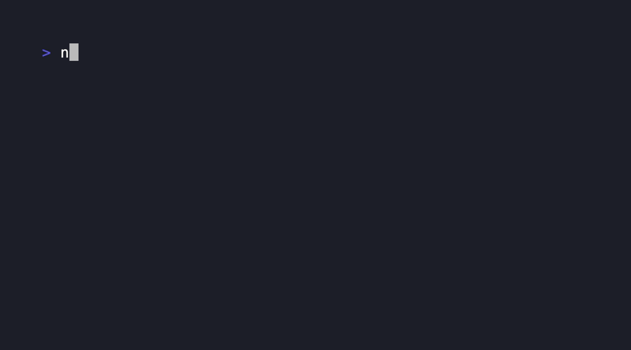

# cowsay-ts

A small, zero-dependency cowsay, in TypeScript, with ESM and CJS builds.



```bash
npm install cowsay-ts
```

## Usage

```ts
import { cowsay } from "cowsay-ts";

console.log(cowsay("Hello!"));
```

```
 _________
< Hello! >
 ---------
        \   ^__^
         \  (oo)\_______
            (__)\       )\/\
                ||----w |
                ||     ||
```

Options:

```ts
cowsay("hi", { animal: "tux", maxWidth: 20 });
```

Available animals: `cow` (default), `tux`, `turtle`, `dragon`, `stegosaurus`,
`moose`, `elephant`, `fox`, `owl`, `octopus`, `hedgehog`, `bunny`, `dolphin`,
`sheep`.

## CLI

```bash
npx cowsay-ts Hello!
echo "piped in" | npx cowsay-ts
npx cowsay-ts -f tux Hello!
```

## Development

```bash
pnpm install
pnpm test
pnpm build
```

Commits follow [Conventional Commits](https://www.conventionalcommits.org),
enforced by commitlint on commit. Releases are CalVer (`vYYYY.M.N`), cut by
hand via the **Release** GitHub Actions workflow, which tags, writes the
changelog with [git-cliff](https://git-cliff.org), and publishes to npm.

## Attribution

Most animal art is ported from the MIT-licensed
[cowsay](https://github.com/piuccio/cowsay) npm package by Fabio Crisci and
contributors, converted from its Perl-template `.cow` format to plain
strings.

## License

MIT
